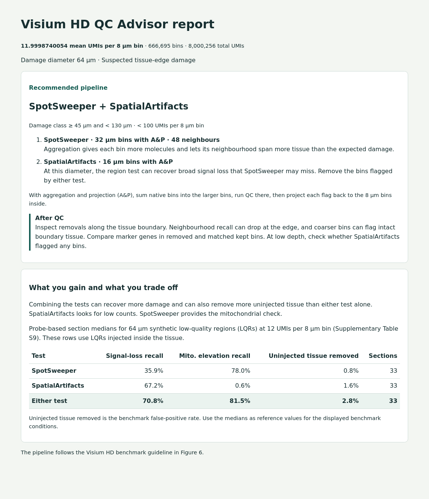

# visiumhd-qc-benchmark

## Contents

- [What the benchmark does](#what-the-benchmark-does)
- [Layout](#layout)
- [Requirements](#requirements)
- [Running the benchmark](#running-the-benchmark)
- [Reproducing the deposited runs exactly](#reproducing-the-deposited-runs-exactly)
- [The QC advisor CLI](#the-qc-advisor-cli)
  - [If the damage size is unknown](#if-the-damage-size-is-unknown)
  - [Example report](#example-report)
- [Citation](#citation)
- [Licence](#licence)

Code for the paper *How should sub-cellular spatial transcriptomics be quality controlled? A guideline from a benchmark with injected damage*. It builds a benchmark with known damage on 40 public Visium HD sections,
runs each quality control (QC) method on it, scores every method against the damage, and
regenerates every figure, table and number in the paper. It also holds the implementation
of the aggregation-and-projection (A&P) approach and a command-line advisor that recommends the paper's
QC settings for a new section.

The benchmark data (injection records, ground truth, every arm's verdict and the scored
tables) are in Zenodo: https://doi.org/10.5281/zenodo.23681224.

---

## What the benchmark does

1. **Depth control.** Each section is thinned by binomial sampling to a mean of 100, 50, 25
   and 12 UMIs per 8 µm bin. A run is one section at one depth.
2. **Synthetic low-quality regions (LQRs).** Circles of 32, 64 and 256 µm are injected at
   known positions as signal loss (each count kept with probability 0.01) or mitochondrial
   elevation (each section's baseline odds raised tenfold), inside the tissue and at its
   edge. On the sections large enough to hold them, 512 µm LQRs are added.
3. **QC arms.** Each arm is one QC method at one bin size: MAD thresholds (scuttle),
   SpotSweeper, SpatialArtifacts, miQC, a fixed UMI cutoff and no filter. An arm on bins
   coarser than 8 µm runs on summed bins and projects each verdict back to the 8 µm bins
   inside (A&P), so every arm reports on the same 8 µm bins.
4. **Scoring.** Recall, cost on the uninjected condition, F1, a marker check of what was
   removed, and the agreement of downstream clusterings between depths.

## Layout

| Path | Content |
|---|---|
| `docker/Dockerfile` | The environment every step runs in |
| `R/ad.R` | A&P: the projection of coarse verdicts back to 8 µm bins |
| `scripts/` | Every step of the benchmark, numbered as they were written |
| `scripts/run_section.sh` | Build and score one run as the Methods describe |
| `scripts/rebuild_run.sh` | Replay one run's injection records and compare with its matrices |
| `scripts/100_make_final.sh` | Regenerate every figure, table and number from a complete grid |
| `qctool/advisor/` | The command-line QC advisor (the procedure of Fig. 6) |
| `data/` | The panel's sources, which runs carry the subset conditions, and the reconstructed injection records (see `data/README.md`) |
| `checks/` | Minimal examples of two package issues the benchmark works around |

The main steps, in the order a run passes them:

| Script | Step |
|---|---|
| `68_fetch_dataset.sh`, `113_zenodo_extract.py` | Download a section's 8 µm files (10x Genomics, Zenodo) |
| `10_inject_artifacts.py` | Thin to a depth, place the LQRs, write the conditions and their coarse views |
| `75_add_coarse_bin.py` | Add 128 µm views to a run |
| `12_run_arms_k48all.R` | Run the QC arms |
| `11_score_benchmark.py` | Score every arm on every condition |
| `50_marker_validation.py` | Marker check of the removed bins |
| `94_downstream_binned.py` | Clustering agreement between 100 and 12 UMIs per bin |
| `136_rebuild_check.py` | Replay a run's recorded injector calls and compare with the run |

The figure and table scripts that `100_make_final.sh` calls are listed in it, each with what
it reads and writes in its header.

---

## Requirements

Docker, about 60 GB of memory for the largest sections (the 11 mm slide), and disk for the
runs: 1.5 to 9 GB each, about 630 GB for the 155 runs of the paper. Build the image from the repository root:

    docker build -f docker/Dockerfile -t vhd-qc-benchmark .

The benchmark ran in an image built from this file on 2026-09-23 on Bioconductor 3.23:
R 4.6.1, scuttle 1.22.0, SpotSweeper 1.8.0, SpatialArtifacts 1.0.0, miQC 1.20.0,
SpatialExperiment 1.22.0; Python 3.12.3 with NumPy 2.1.3, SciPy 1.14.1, pandas 2.2.3,
pyarrow 18.1.0, scanpy 1.11.5, anndata 0.11.4, leidenalg 0.10.2, igraph 0.11.9 and
scikit-learn 1.5.2. All packages are release builds used as published.

Every container goes through `scripts/00_slot.sh`, which holds the number of benchmark
containers at `CAP` (default 5). Paths are relative to the repository root, or to
`VHDQC_ROOT` when it is set; inside the container the root is mounted at `/work` and the
section's `binned_outputs` at `/src`.

## Running the benchmark

Fetch a section, then build its runs:

    bash scripts/68_fetch_dataset.sh Visium_HD_Mouse_Embryo 4.0.1     # name and Space Ranger version, see data/sources.tsv
    for d in 100 50 25 12; do bash scripts/run_section.sh Visium_HD_Mouse_Embryo $d; done

The six-cancer sections are read from their Zenodo zip without downloading it whole:

    python3 scripts/113_zenodo_extract.py visiumhd_Bladder.zip Visium_HD_SixCancer_Bladder_Cancer 297675

For Figure 4b and 4c, run downstream clustering once for each section scored at both 100 and
12 UMIs per bin. The command appends to `benchmark_grid/figures/downstream_binned.csv`.
For example:

    docker run --rm -v "$PWD":/work vhd-qc-benchmark /opt/pyenv/bin/python \
      /work/scripts/94_downstream_binned.py --section Visium_HD_Mouse_Embryo --bin 32 \
      --arms 01_no_qc,02_mad_8um,10_mad_64um,24_spotsweeper_8um_k48,27_spotsweeper_64um_k48,19_spatialartifacts_8um,20_spatialartifacts_16um

Figure S9 also uses uninjected MAD runs at 13 additional depths. For each section, build
those runs from its native `binned_outputs`. The builder skips target depths above the
section's native depth:

    section=Visium_HD_Mouse_Embryo
    docker run --rm -v "$PWD":/work vhd-qc-benchmark /opt/pyenv/bin/python \
      /work/scripts/145_molecule_curve_build.py --src "/work/public/$section/binned_outputs" \
      --out-root /work/benchmark_molcurve --name "$section" \
      --depths 200 90 80 70 60 22 20 18 15 6 5 4 3

Score each of the resulting runs. For example, to score the embryo at 90 UMIs per bin:

    run=/work/benchmark_molcurve/Visium_HD_Mouse_Embryo_d90
    docker run --rm -v "$PWD":/work vhd-qc-benchmark Rscript \
      /work/scripts/12_run_arms_k48all.R --benchmark "$run" --conds clean \
      --arms 02_mad_8um,08_mad_16um,09_mad_32um,10_mad_64um
    docker run --rm -v "$PWD":/work vhd-qc-benchmark /opt/pyenv/bin/python \
      /work/scripts/11_score_benchmark.py --benchmark "$run" --results "$run/results" --out "$run/scored"

With the scored grid, downstream CSV and additional MAD runs in place, generate the
figures and tables. If the S5 source PNGs, the colon cancer clustering labels, or the
shared `summary.csv` are missing, `122_demo_downstream_maps.py` rebuilds them from the
uninjected 8 µm matrices and QC verdicts at 100 and 12 UMIs per bin before Figure 4 is
drawn. Figure 4a uses the colon cancer labels and the shared summary. Install
`rsvg-convert` on the host to export PNGs from the methods diagrams.

    IMG=vhd-qc-benchmark bash scripts/100_make_final.sh

To assemble the manuscript's figure and table files, pass your local main and
supplementary Markdown files to the exporter:

    python3 scripts/export_manuscript_tables.py \
      --manuscript /path/to/manuscript_draft.md \
      --supplement /path/to/supplementary_draft.md \
      --final-output

This writes the manuscript PNGs, UTF-8 CSVs with a byte-order mark, and the original
`tableS1.txt` to `benchmark_grid/figures/final_output`.

## Reproducing the deposited runs exactly

The deposit holds each run's injection records (`injection_params*.json`), one per call of
the injector, and the ground truth of every condition, but not the count matrices. A call is
deterministic given its arguments and seed, so replaying a run's calls on the public section,
in the order the run was built (the call that built it, then the edge, 512 µm and
mitochondrial re-injection calls), rebuilds its matrices bin for bin. To rebuild a run, call
`scripts/10_inject_artifacts.py` with each record's arguments in that order;
`scripts/136_rebuild_check.py` shows how a record maps to the arguments. Where the run's
matrices are on disk, `scripts/rebuild_run.sh` replays its calls and compares every condition
with them:

    bash scripts/rebuild_run.sh Visium_HD_Human_Lymph_Node_FFPE_d12

The deposited runs were built in stages as the design grew, so not every run was made in
the single pass of `run_section.sh`. On 24 runs the record of the call that built the run was
overwritten by a later call. `data/README.md` describes the stages, lists these runs and gives
their reconstructed records, in `data/reconstructed/`, with how they were checked.

---

## The QC advisor CLI

The Visium HD QC Advisor reads a section's filtered 8 µm gene-expression matrix and barcodes,
computes the mean UMIs per bin, and recommends the QC tests and settings in Fig. 6.
It writes a standalone HTML report with the reason for each choice and the measured recall
and false-positive rates for the relevant benchmark conditions.

Use Node.js 16.20 or later and run the command from the repository root.

```sh
node qctool/advisor/qc-advisor.cjs \
  --input /path/to/outs/binned_outputs/square_008um/filtered_feature_bc_matrix \
  --damage-um 64 --edge --out qc-report.html
```

**Parameters**

- `--input DIRECTORY` **(required)**. Space Ranger's `outs/binned_outputs/square_008um/filtered_feature_bc_matrix` directory. It must contain `matrix.mtx.gz` and `barcodes.tsv.gz`, or their decompressed versions.
- `--damage-um DIAMETER` **(optional)**. Estimated damage diameter in µm from the tissue image.
- `--edge` **(optional)**. Adds guidance on checking removals along the tissue boundary when damage is suspected there.
- `--out FILE` **(optional)**. Path to the HTML report. Defaults to `qc-advisor-report.html`. Open the report in a browser.
- `-h`, `--help` **(optional)**. Prints usage and exits.

### If the damage size is unknown

Omit `--damage-um` if you cannot estimate the diameter or see no damage. The advisor uses
the mean UMI count to recommend a bin size for a section-wide median absolute deviation
(MAD) threshold.

```sh
node qctool/advisor/qc-advisor.cjs \
  --input /path/to/outs/binned_outputs/square_008um/filtered_feature_bc_matrix
```

### Example report

This report uses a public kidney section at approximately 12 UMIs per 8 µm bin, with
64 µm and tissue-edge damage supplied as example inputs.



---

## Citation

[citation of the paper, to be added on publication]

## Licence

MIT, see `LICENSE`. The Visium HD sections are released by their producers under CC BY 4.0
(`data/sources.tsv`).
